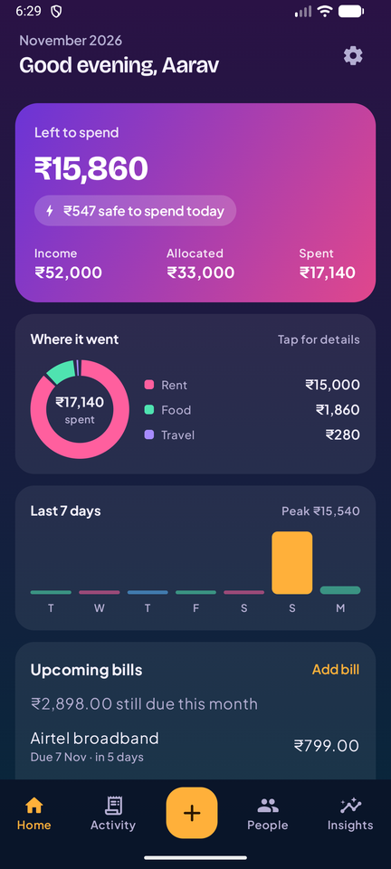
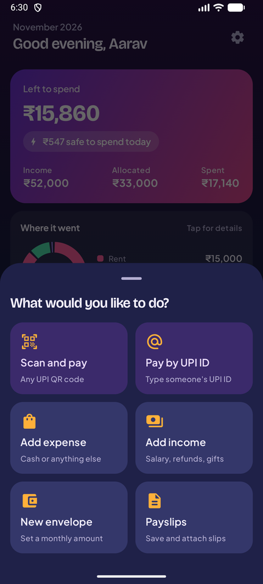
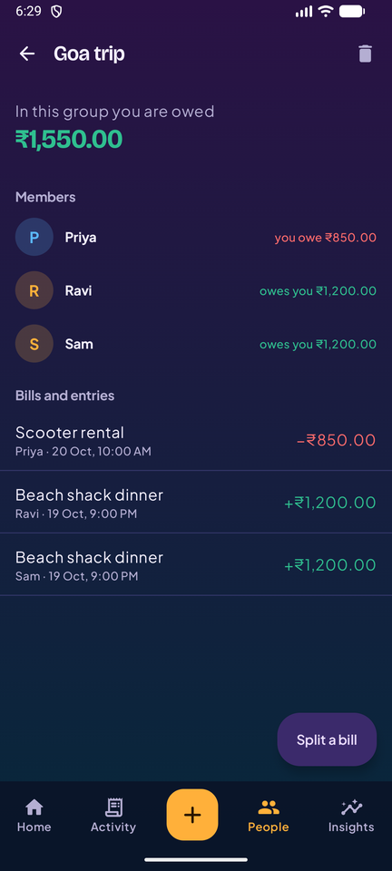
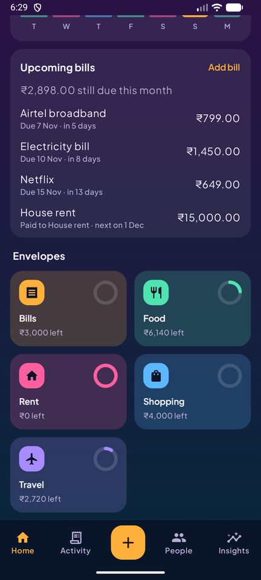
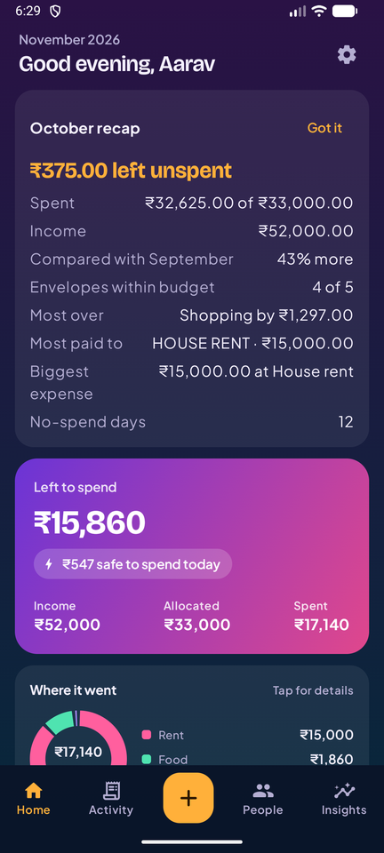
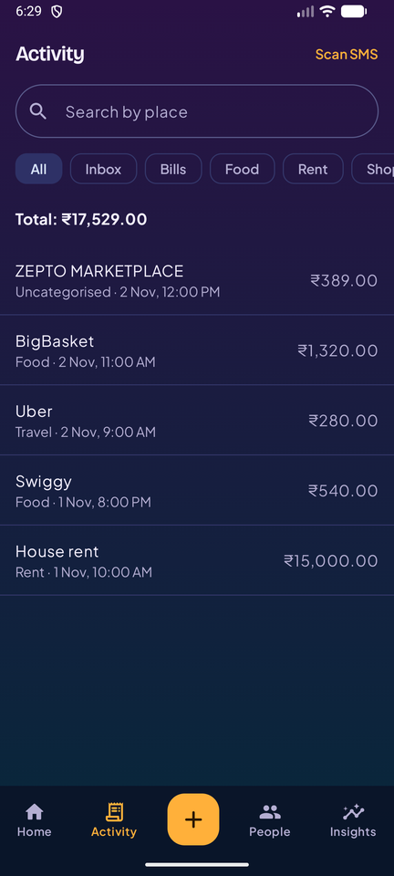
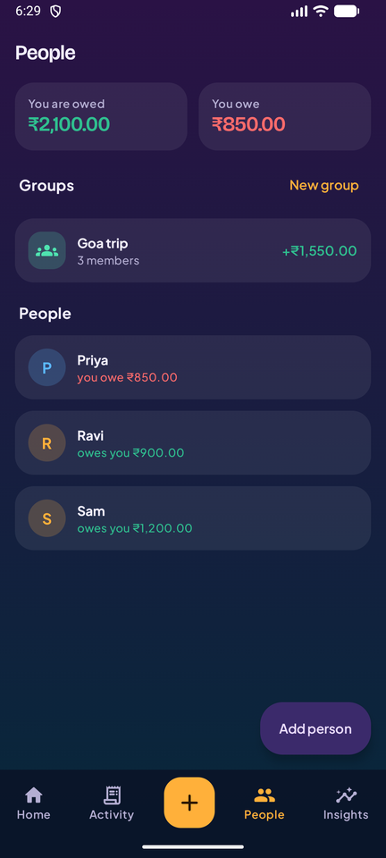
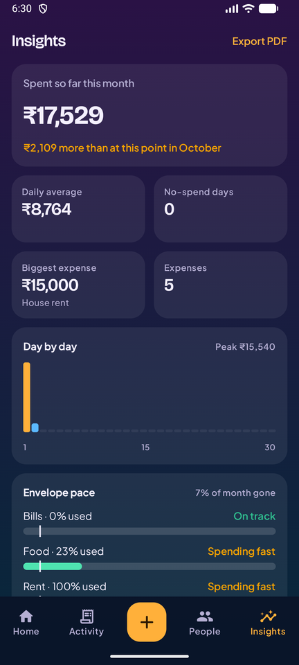

<div align="center">

# SplitPocket

**An offline budgeting app for Android, built for how money moves in India: UPI, bank SMS and splitting bills with friends.**

Give every rupee a job, see where it went, and settle up with friends, all without your data leaving the phone.


&nbsp;
&nbsp;


</div>

---

## What it is

SplitPocket combines **envelope budgeting** and **Splitwise-style bill splitting** in one Android app.

1. Split your monthly income into envelopes such as Rent, Food and Travel.
2. Pay through UPI from inside the app, or let it pick up payments from your bank SMS and payment-app notifications.
3. Each expense lands in an envelope, so you always know what is left to spend.
4. Spending shared with friends is tracked per person and per group, and settling up counts as your own spending.

**Everything stays on your phone.** The app does not ask for the internet permission. There is no account, server, cloud sync, ads or tracking.

## Features

### Budgeting
- **Envelopes.** Set a monthly amount per envelope and watch it fill up as you spend.
- **Left to spend and "safe to spend today".** Your remaining budget spread over the days left in the month.
- **Income.** Salary and other income, plus payslips with the PDF or photo attached. A payslip's net pay can be added as that month's income.
- **Upcoming bills.** Rent, EMIs and subscriptions with due dates. A bill is marked paid automatically when a matching payment, by payee and amount, shows up. The app also suggests bills from payments that repeat every month.

### Capturing spending automatically
- **Bank SMS.** Debit messages from Indian banks are read and turned into expenses.
- **Payment-app notifications.** Catches payments from Google Pay, PhonePe, Paytm, CRED, BHIM, Navi and super.money, including small UPI payments your bank never sends an SMS for.
- **No double counting.** The same payment seen by SMS, by notification and by hand is recorded once.
- **File it from the notification.** Each new expense pops up with buttons for your envelopes. Tap one to file it without opening the app.
- **Payee rules.** Remember that a payee always goes to the same envelope.

### Paying
- **Scan and pay.** Scan any UPI QR code, or type a UPI ID. Your UPI app opens to pay, and the expense is filed in the envelope you picked.

### Splitting with friends
- **People and groups.** Track who owes you and whom you owe, per person and per group, such as a trip or a flat.
- **Split a bill.** Split a group bill equally, or split an expense you already paid equally, by exact amounts or by percentages.
- **Settle up.** Paying someone back is recorded as spending in the envelope you choose.
- **Reminders.** Send a polite WhatsApp reminder with the amount filled in.

### Seeing where it went
- **Insights.** Spending by day, envelope pace against the month, biggest expenses and no-spend days.
- **Monthly recap.** For the first week of each month: what was left, how it compares with the month before, and which envelope went over.
- **PDF export.** A tidy one-month report to save or share.
- **Home-screen widget.** Shows what is left in each envelope at a glance.

### Privacy and safety
- **App lock** with your fingerprint or screen lock.
- **Encrypted backup and restore**, protected by a password you choose (AES-256-GCM, with the key derived using PBKDF2). Move to a new phone without any cloud.
- **No internet permission at all**, so the app cannot send your data anywhere.

## Screenshots

| Home | Envelopes and bills | Monthly recap | Quick actions |
|:---:|:---:|:---:|:---:|
|  |  |  |  |

| Activity | People | Group split | Insights |
|:---:|:---:|:---:|:---:|
|  |  |  |  |

<sub>The screenshots use made-up demo data.</sub>

## Tech stack

| Area | What it uses |
|---|---|
| Language | Kotlin 2.2 |
| UI | Jetpack Compose with Material 3, a custom dark and light theme |
| Storage | Room (SQLite) with step-by-step migrations. Money is stored as whole paise, never as floating point |
| Architecture | Screen → ViewModel (StateFlow) → Repository → DAO, wired by hand with no DI framework |
| Widget | Jetpack Glance |
| Capture | SMS `BroadcastReceiver` and a `NotificationListenerService` |
| Payments | UPI deep links (`upi://pay`) and the Google code scanner for QR codes |
| Security | AndroidX Biometric for app lock, AES-GCM with PBKDF2 for backups |
| Export | Android `PdfDocument` |
| Build | Gradle (Kotlin DSL), AGP 9, version catalog. Min SDK 26 (Android 8.0), target SDK 37 |

## Project structure

```
app/src/main/java/com/example/budgetapptracker/
├── data/        Room entities, DAO, repository, budgeting and split math
├── sms/         Bank SMS parsing and import
├── notify/      Payment-app notification capture and expense notifications
├── pay/         UPI links and the pay flow
├── backup/      Encrypted backup and restore
├── export/      Monthly PDF report
├── payslip/     Payslip file storage
├── security/    App lock
├── widget/      Home-screen widget
└── ui/          Compose screens: home, transactions, people, insights, bills, recap…
```

## Build and run

1. Clone the repo and open it in a recent **Android Studio**.
2. Let Gradle sync, then run the `app` configuration on a phone or emulator running Android 8.0 or later.

Release builds are signed with a private key that is not in this repository. Without it, Android Studio builds a debug version that runs normally.

### Permissions it asks for, and why

| Permission | Why |
|---|---|
| Read and receive SMS | To turn bank debit messages into expenses |
| Notification access | To catch payments from UPI apps |
| Post notifications | To show new expenses with envelope buttons |
| Biometric | For the optional app lock |

All of these are optional. The app works with manual entries alone.

## Status

SplitPocket is in **testing with a small group of users** (version 1.1). Planned next:
- unspent money rolling over to the next month
- savings goals
- a Play Store release

---

<div align="center">
Built by <a href="https://github.com/koushik-081">Koushik Saraswathula</a>
</div>
